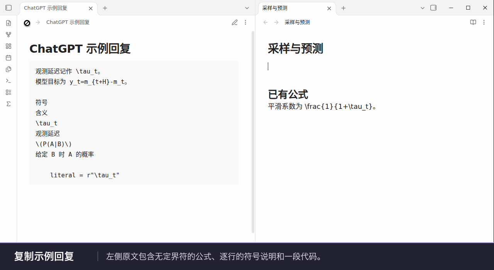
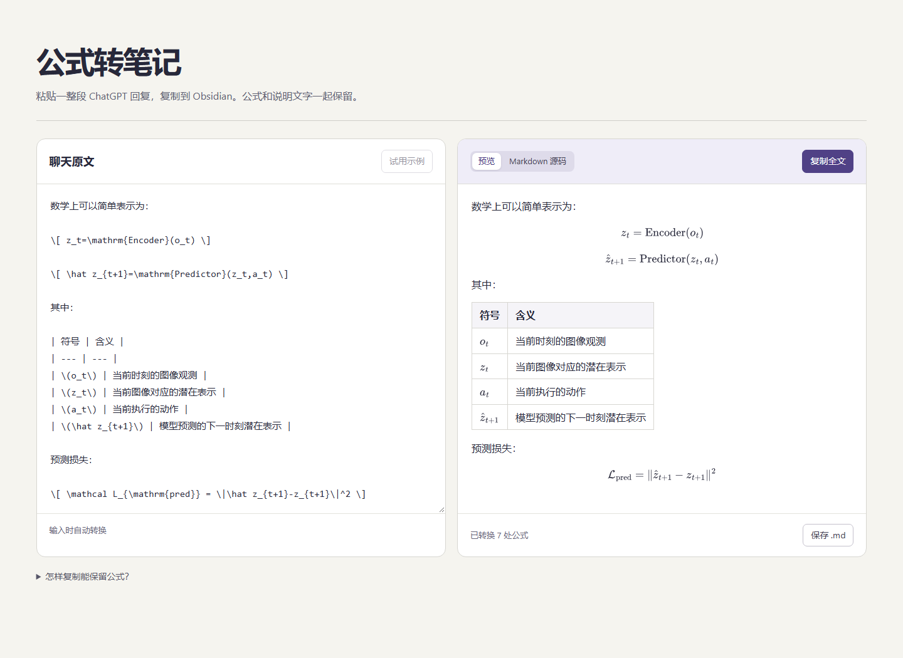

# Formula to Note

[简体中文](README.md) · **English**

**[Install the Obsidian plugin](#obsidian-plugin)** · [Official plugin page](https://community.obsidian.md/plugins/formula-to-note) · [Open the web app](https://zhibird.github.io/gptchat-to-obsidian/) · [Download offline HTML](https://github.com/zhibird/gptchat-to-obsidian/releases/latest/download/gptchat-to-obsidian.html)

Turn ChatGPT replies with equations, symbol tables, images, and references into Obsidian notes. Paste directly into the note editor with the plugin, or preview the converted Markdown in the standalone web app.

## Obsidian demo

Pasting the sample reply immediately formats `\tau_t` and `y_t=m_{t+H}-m_t` and rebuilds the symbol table. Later in the demo, the **Σ** button formats a fraction already in the note. The conditional probability `P(A|B)` stays in one table cell, and the indented code keeps the original `\tau_t`.



Recorded with Obsidian 1.15.0 and Formula to Note 1.4.0. [Download the version shown](https://github.com/zhibird/gptchat-to-obsidian/releases/download/1.4.0/formula-to-note.zip) · [Installation instructions](#obsidian-plugin)

## Obsidian plugin

**Formula to Note** works in the note editor with Obsidian 1.5.0 or later.

### Install in Obsidian

1. Open **Settings → Community plugins**. If prompted, select **Turn on community plugins**.
2. Select **Browse**, search for **Formula to Note**, and open the result by **zhibird**.
3. Select **Install**, then **Enable**. You can also start from **Add to Obsidian** on the [official plugin page](https://community.obsidian.md/plugins/formula-to-note).

### Manual installation

1. Download `formula-to-note.zip` and extract it into your vault's `.obsidian/plugins/` directory. The resulting `.obsidian/plugins/formula-to-note/` folder should contain `main.js` and `manifest.json`. To install from a source build, copy `dist/formula-to-note/` into the same plugins directory. [Latest GitHub release](https://github.com/zhibird/gptchat-to-obsidian/releases/latest)
2. Reload Obsidian and enable **Formula to Note** under **Settings → Community plugins**.

### Usage

Copy a derivation from the chat reply and paste it into the note body. Obsidian inserts the converted content.

**Convert on paste** is on by default. You can turn it off or back on under **Settings → Formula to Note**.

To format material already in a note, click **Σ** in the left ribbon. It converts the selection if you have one, or the whole note if you have a single cursor. Clicking it in Reading view opens the same note in edit mode and converts it. A single Undo restores the previous content. The **Convert selected text to a formula note** command is also available from the command palette.

Expressions such as `\tau_t` and `y_t=m_{t+H}-m_t` get `$...$` delimiters in prose and table cells. The parser looks for signals such as known TeX commands, braced scripts, and numeric superscripts. Bare identifiers such as `a_b` and filenames keep their original text.

Conditional probabilities, norms, and display formulas retain their table cells. The plugin preserves inline code, fenced and indented code blocks, and note properties. Obsidian handles file pastes, multi-cursor pastes, and internal copies through its standard clipboard behavior. The conversion runs locally.

## Web app

Use the preview to check equations and tables before copying the converted note. The downloadable HTML file also works offline.

1. Open the web app or download and open the offline HTML file.
2. Choose **试用示例** (Load example) or paste a chat reply into the left pane. The reply's copy button usually includes the original TeX. Selecting and copying the reply can also include images and links.
3. Check the rendered result on the right. Choose **Markdown 源码** (Markdown source) to inspect the exact text, **复制全文** (Copy all) to copy it, or **保存 .md** (Save .md) to save a note.



## Conversion example

Copy this text with LaTeX delimiters.

```text
The prediction loss is
\[ \mathcal L_{\mathrm{pred}} = \|\hat z_{t+1}-z_{t+1}\|^2 \]
Here, \(z_{t+1}\) is the latent vector at the next time step.
```

The converter produces Obsidian Markdown.

```markdown
The prediction loss is
$$
\mathcal L_{\mathrm{pred}} = \|\hat z_{t+1}-z_{t+1}\|^2
$$
Here, $z_{t+1}$ is the latent vector at the next time step.
```

The tool can recover TeX from web formulas that carry source annotations and repair some extra escaping in subscripts and norms. It can also reconstruct a two-column glossary when copying flattens the Chinese `符号` (Symbol) and `含义` (Meaning) columns into separate lines.

Preference examples with `Prompt`, `Response A/B`, and `Chosen/Rejected` labels become Obsidian callouts for the prompt and both responses. [See an example](docs/preference-example.md)

## Images and offline use

Text conversion, math rendering, and table previews run locally. Previewing a remote image requests it from the image's host. Exported notes contain the image URL, so the image depends on the host's availability and access permissions. For a copied image or drawing without a usable URL, save it separately and drag it into Obsidian.

## Comparison with related plugins

| Project | How conversion runs | Use cases |
| --- | --- | --- |
| Formula to Note | Paste handler, Σ ribbon button, selection command, and standalone web app | Recognize bare TeX, restore Chinese symbol tables, and format conditional probabilities and display equations within cells |
| Math Paste Bridge 1.0.6 | Paste handler that recovers TeX and checks the surrounding Markdown | Recognize TeX and algebra without delimiters, including `\tau_t` and `y_t=m_{t+H}-m_t` |
| Transfer LaTeX from GPT | Command or ribbon button that reads the current file and replaces formula delimiters | Convert equations throughout an existing note |

Formula to Note and Math Paste Bridge both recover TeX from rich text with LaTeX annotations. Formula to Note adapts its grammar for expressions without delimiters. Transfer LaTeX from GPT inspired the location of the Σ button. [Math Paste Bridge README](https://github.com/hlyang1992/math-paste-bridge/blob/449357f29808f59418cef21ed50c8f8216a00f0d/README.md) · [Transfer LaTeX from GPT button implementation](https://github.com/xixia123/obsidian-transfer-latex-from-gpt/blob/4ae70733d602445656fabf65e12c674f8e3d862d/main.ts)

## Development and releases

Use Node.js 24 and npm. Run `npm ci` to install the development dependencies, `npm test` to run the regression tests, and `npm run build` to generate `dist/gptchat-to-obsidian.html` and `dist/formula-to-note/`. You can also open `index.html` directly during web development.

For a conversion issue, include a redacted copy of the original input, how you copied it, and the expected Markdown. [Input and expected-output fixtures](test/fixtures)

For a release, update the version in `manifest.json`, `versions.json`, and the npm package. Push a tag that matches the plugin version exactly, such as `1.5.0`. After testing and building, GitHub Actions creates a release draft with the plugin bundle, installation ZIP, and offline HTML. A first listing in the Community plugins directory requires a separate submission. [Obsidian plugin submission guide](https://docs.obsidian.md/plugins/releasing/submit-plugin)

## License

The project is licensed under MIT. The bundled markdown-it 14.1.0, MathJax 3.2.2, and the TeX recognition code adapted from Math Paste Bridge carry their own notices. [Project license](LICENSE) · [Third-party notices](THIRD-PARTY-LICENSES.txt)
