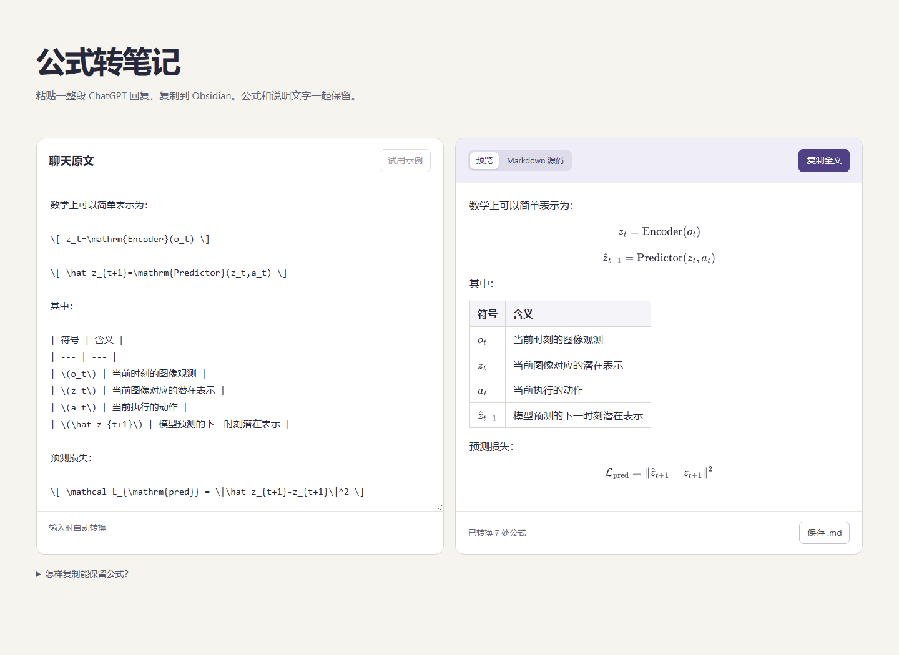

# 公式转笔记 · GPTChat to Obsidian

**[在线使用 →](https://zhibird.github.io/gptchat-to-obsidian/)**　·　[下载离线版](https://github.com/zhibird/gptchat-to-obsidian/releases/latest/download/gptchat-to-obsidian.html)

把含公式、符号表、图片和参考链接的 ChatGPT 回复整段粘贴进来，在右侧预览后，一次复制到 Obsidian。

**一段推导，只复制一次。** 大公式、正文里的变量和符号解释按原顺序放进同一篇笔记。右侧可以先看清下标、分式和表格，再决定是否复制。浏览器打开即用，公式预览支持离线。



## 使用

1. 点击上方「在线使用」打开工具。需要离线使用时，下载单文件版并用浏览器打开。
2. 点击「试用示例」查看效果，或把聊天回复粘贴到左栏。公式优先使用回复的复制按钮，带有图片与来源链接的内容也可以框选复制。
3. 在右栏检查公式和表格。切到「Markdown 源码」可以核对原始字符。点击「复制全文」粘贴进 Obsidian，或点击「保存 .md」保存成笔记。

## 转换示例

输入：

```text
预测损失为
\[ \mathcal L_{\mathrm{pred}} = \|\hat z_{t+1}-z_{t+1}\|^2 \]
其中，\(z_{t+1}\) 表示下一时刻的潜在向量。
```

输出：

```markdown
预测损失为
$$
\mathcal L_{\mathrm{pred}} = \|\hat z_{t+1}-z_{t+1}\|^2
$$
其中，$z_{t+1}$ 表示下一时刻的潜在向量。
```

工具也能从带有 LaTeX 源码的网页公式中提取数学表达式，修复部分下标和范数符号的多余转义。对于复制后变成逐行文本的「符号 / 含义」两列表，它会尝试还原表格。

复制同时包含 Prompt、Response A/B 和 Chosen/Rejected 标签的偏好学习示例时，工具会把问题和两份答案排成 Obsidian 提示框。[查看示例](docs/preference-example.md)

## 图片与离线使用

文本转换、公式排版和表格预览均在本机完成。预览远程图片时，浏览器会向图片所在网站请求图片。导出的笔记保留图片网址，显示效果取决于链接是否有效以及网站的访问权限。复制时缺少可用网址的图片或网页绘图，可另存后拖入 Obsidian。

## 开发

界面入口是 `index.html`，转换和预览逻辑在 `src/app.js`，样式在 `src/style.css`。直接打开入口即可运行。发布单文件版本时，在仓库根目录运行 `node scripts/build.mjs`，生成的文件位于 `dist/gptchat-to-obsidian.html`。

仓库内附 markdown-it 14.1.0 和 MathJax 3.2.2，第三方许可证见 [THIRD-PARTY-LICENSES.txt](THIRD-PARTY-LICENSES.txt)。
